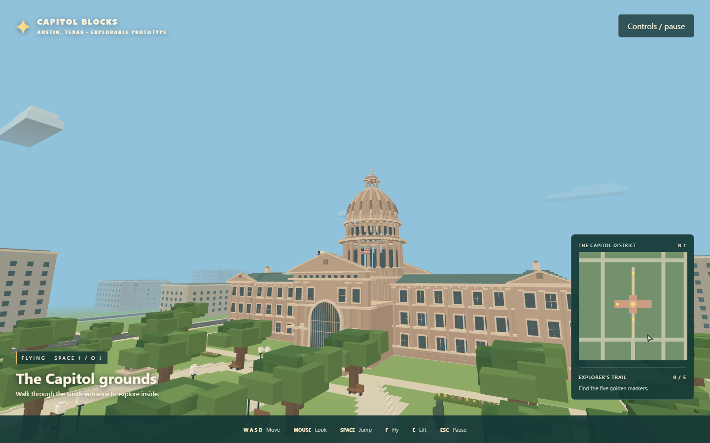

# Capitol Blocks

A self-contained first-person browser game inspired by Texas Capitol site maps and floor plans. No install, account, server, or internet connection required.

**[Play in your browser](https://kelleyparker.github.io/capitol-blocks/)**

Double-click **start-game.cmd** (Windows), or open **index.html** in Chrome, Edge, or Firefox. Click **Explore the Capitol**. If mouse lock is unavailable, hold the left mouse button and drag to look.

## Controls

- WASD / arrow keys: move; mouse: look.
- Shift: faster movement; Space: jump.
- F: toggle free flight; Space / Q: ascend / descend. Flight passes through walls for exploration.
- E: open the elevator floor selector on the green pad in the north lobby. Choose basement, first floor, or second floor.
- Walk outward along the center of either wing to climb the stairs to the second floor; walk inward to descend. No jumping required.
- R: return to Congress Avenue. Escape: pause and release mouse.

Find five golden markers: south promenade, rotunda, west wing, northern extension courtyard, and basement rotunda. Progress lasts for the current browser session.

The Capitol has a hollow voxel dome, columned south entrance, four connected lobbies/corridors, office alcoves, a simplified basement, and a second floor with guarded rotunda balconies. Two walkable staircases and a three-stop elevator connect the explorable levels. The district includes Congress Avenue, Colorado and Brazos streets, lawns, trees, nearby buildings, and the northern extension courtyard. Interiors follow the supplied cross-shaped floor plan approximately; the upper galleries and stair placement are stylized additions, not a measured replica or wayfinding tool. Exact room numbers, working traffic, and block editing are not implemented.

The photo-inspired exterior includes granite facade courses, pilasters, framed windows, arched porticos, walkable entrance steps, copper roofs, end pavilions, and a layered dome with columns, ribs, a lantern, and a block statue. Oak-lined paths, curved drives, globe lamps, flower beds, monuments, and extension courtyard details focus exploration on the Capitol property.

Rendering uses native WebGL with no third-party libraries or remote assets. Desktop keyboard and mouse required. Source is in index.html, style.css, game.js, and exterior.js.

## Publishing

GitHub Actions automatically publishes the game to GitHub Pages on every push to `main`. The workflow validates JavaScript syntax, uploads the game files, and deploys the site. You can also run **Publish game to GitHub Pages** manually from the repository's Actions tab. Changes must be committed and pushed to GitHub to trigger publishing.
